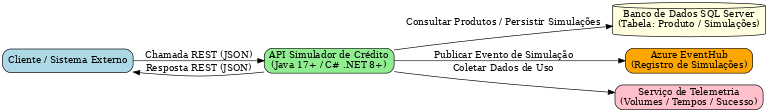

# API Simulador de Crédito

## Descrição
Este projeto é uma API desenvolvida em Spring Boot para simulação de crédito bancário, conforme desafio técnico. Permite que qualquer pessoa ou sistema realize simulações de empréstimo, retornando condições de negociação e cálculos dos sistemas de amortização SAC e PRICE.

## Funcionalidades
- Receber solicitações de simulação via JSON
- Consultar produtos parametrizados em banco SQL Server
- Validar dados de entrada conforme parâmetros dos produtos
- Filtrar produtos adequados à solicitação
- Calcular parcelas nos sistemas SAC e PRICE
- Persistir simulações realizadas em banco local
- Enviar eventos de simulação para o EventHub
- Endpoints para consulta de simulações, valores por produto/dia e telemetria

## Arquitetura
```
[Usuário/Postman] --> [API Simulador] --> [Banco SQL Server]
                                 |--> [EventHub]
                                 |--> [Banco Local]
```
- API RESTful documentada via Swagger
- Integração com SQL Server para consulta de produtos
- Persistência de simulações em banco local
- Envio de eventos para EventHub
- Métricas expostas para Prometheus

## Como rodar o projeto
1. **Pré-requisitos:**
    - Docker e Docker Compose instalados
    - JDK 21+
    - Maven
2. **Configuração:**
    - Variáveis de ambiente no já estipuladas no `application.properties` para acesso ao SQL Server e EventHub
3. **Execução via script para criar o package e rodar o docker-compose:**
    - Windows:
   ```bash
   start.bat
   ```
    - Linux/Mac:
   ```bash
   chmod +x start.sh
   ./start.sh
   ```
4. **Execução via Docker Compose sem rodar o script:**
   ```bash
   mvn clean package
   docker-compose up --build
   ```
    - A API estará disponível em `http://localhost:8080`
5. **Execução local:**
   ```bash
   mvn spring-boot:run
   ```
6. **Endpoint Público:**
   A API está disponível publicamente em uma instância EC2 da AWS, configurada para acesso externo via IP público. O ambiente foi provisionado e configurado para garantir segurança e disponibilidade.

- http://54.207.33.166:8080

  Qualquer pessoa pode acessar este endpoint, desde que as regras de segurança estejam configuradas corretamente na instância AWS/EC2. O endpoint público está incluído na coleção Postman disponível no projeto (`/docs/Hackaton2025.postman_collection.json`), facilitando testes automatizados e integração.

## Segurança e Autenticação JWT
A partir desta versão, todos os endpoints protegidos exigem autenticação via token JWT. Para acessar os recursos, siga o fluxo abaixo:

- **Gerar Token de Acesso:**
  - Endpoint: `POST /auth/token`
  - Corpo da requisição (JSON):
    ```json
    {
      "usuario": "hackathon",
      "password": "2025"
    }
    ```
  - Exemplo de resposta (sucesso):
    ```json
    {
      "token": "<seu_token_jwt>",
      "tipo": "Bearer",
      "usuario": "hackathon",
      "expiraEm": 3600
    }
    ```
  - Se as credenciais estiverem incorretas, será retornado HTTP 401.
  

- **Utilizar o Token nos Endpoints Protegidos:**
  - Adicione o header `Authorization` em todas as requisições:
    ```
    Authorization: Bearer <seu_token_jwt>
    ```
  - Sem o token ou com token inválido, a API retorna HTTP 403 e mensagem de erro.


- **Endpoints públicos:**
  - O endpoint `/auth/token` não exige autenticação.
  - Endpoints de documentação Swagger e métricas também são públicos.

## Endpoints da API

- **POST /simulacoes**: Realiza uma simulação de crédito
- **GET /simulacoes**: Lista todas as simulações realizadas
- **GET /simulacoes/por-dia?data=**: Retorna valores simulados por produto em cada dia
- **GET /simulacoes/telemetria**: Retorna dados de telemetria

## Visualização dos Dados via Navegador
Além do consumo dos endpoints via API, é possível visualizar os dados diretamente no navegador utilizando templates Thymeleaf, proporcionando uma experiência visual mais clara e detalhada das respostas.

Para uma melhor experiência visual, recomenda-se instalar uma extensão ou servidor de linguagem CSS no seu editor, garantindo que os estilos dos templates sejam renderizados corretamente durante o desenvolvimento.

Os principais endpoints de visualização são:
- `/simulacoes-view`: Lista de simulações realizadas
- `/simulacoes-por-dia-view`: Simulações agrupadas por dia
- `/telemetria-view`: Dados de telemetria e métricas da API

Esses endpoints utilizam templates HTML para exibir as informações de forma organizada e intuitiva, facilitando o entendimento dos dados retornados pela API. Todos os endereços estão definidos no controller de visualização (`SimulacaoViewController`).

## Testes
- **Testes unitários:**
  ```bash
  mvn test
  ```
- **Testes de integração:**
  Incluídos no projeto, simulando banco de dados e integrações
- **Cobertura de testes:**
  ```bash
  mvn clean test jacoco:report
  ```
  Relatório gerado em `/target/site/jacoco/index.html`

- **Cobertura de testes:**

## Documentação da API
- Swagger disponível em: `http://localhost:8080/swagger-ui.html`
- Exemplos de requisições e respostas documentados
- Erros tratados: 400, 401, 403, 404, 500

## Coleção Postman
- Coleção pronta disponível em `/docs/Hackaton2025.postman_collection.json`

## Métricas e Telemetria
- Métricas expostas para Prometheus em `/actuator/prometheus`
- Endpoint de telemetria: `/simulacoes/telemetria`

## Pipeline CI/CD
- Pipeline configurado no GitHub Actions para build e testes automáticos
- Link: [Pipeline no GitHub](https://github.com/rodriguesla/api-simulador/actions)

## Diagrama de Arquitetura !!!MELHORAR!!!


## Observações !!!A FAZER!!!
- Estratégias de cache, circuit break e rate limit podem ser implementadas conforme necessidade
- Auditoria de operações disponível
- Resultados de teste de carga com K6/JMeter disponíveis em `/docs/tests`

## Contato
- Desenvolvedor: [Luciano Aymone Rodrigues]
- Email: luciano.a.rodrigues@caixa.gov.br
